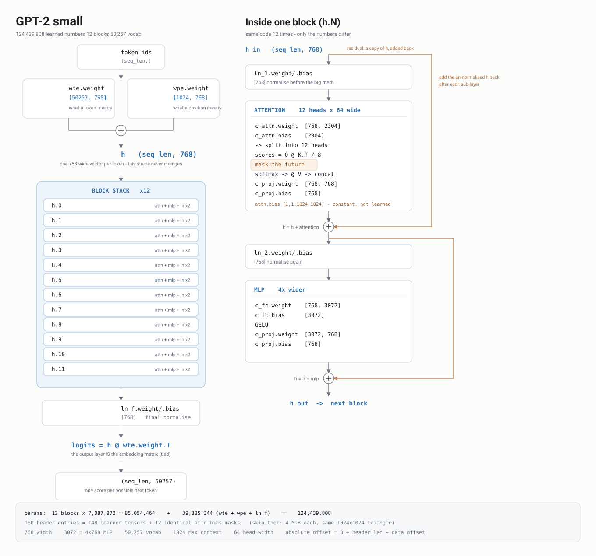

# GPT-2 small (124M) — architecture & safetensors reference

Reference notes for `artifacts/gpt2-safetensors-header.json` (header of the HF `gpt2` weights).
Poster version, annotated and zoomable: [`gpt2-architecture.svg`](gpt2-architecture.svg)



---

## 1. The model, top to bottom

```
 token ids:  [464, 3797, 3332]                 shape: (seq_len,)

      +----------------------+   +-----------------------+
      | wte.weight           |   | wpe.weight            |
      | [50257, 768]         |   | [1024, 768]           |
      | what a token means   |   | what a position means |
      +----------+-----------+   +-----------+-----------+
                 | row lookup                | row lookup
                 +------------> + <----------+
                                |
                                v
                        h   (seq_len, 768)      <- the 768-wide vector
                                |                  that flows through
                 +--------------+--------------+   everything
                 |  BLOCK  h.0                 |  -+
                 +-----------------------------+   |
                 |  BLOCK  h.1                 |   |  12 blocks,
                 +-----------------------------+   |  same shapes,
                 |  BLOCK  h.2                 |   |  different
                 +-----------------------------+   |  numbers
                 |            ...              |   |
                 +-----------------------------+   |
                 |  BLOCK  h.11                |   |
                 +--------------+--------------+  -+
                                |
                                v
                    ln_f.weight/.bias [768]         final normalise
                                |
                                v
                   logits = h @ wte.weight.T        wte reused (tied)
                                |
                                v
                    (seq_len, 50257)                one score per
                                                    possible next token
```

The **blocks are the middle stack** — everything between the embedding lookup and the final
LayerNorm. Repeated 12 times; embeddings and `ln_f` happen once.

## 2. Inside one block (`h.N`)

```
   in  h  (seq_len, 768)
     |
     v
  ln_1.weight/.bias [768]          normalise before the big matrix math
     |
     v
  ATTENTION (12 heads x 64)
  ------------------------------------------------------------
     c_attn.weight [768, 2304]     one matmul -> Q, K, V
     c_attn.bias   [2304]
     -> split into 12 heads x 64 wide
     scores = Q @ K.T / 8          (seq, seq)
     mask the future               <- attn.bias lives here
     softmax -> @ V -> concat heads back to 768
     c_proj.weight [768, 768]
     c_proj.bias   [768]
  ------------------------------------------------------------
     |
     v
   (+)  h = h + attention          adds the input back
     |
     v
  ln_2.weight/.bias [768]
     |
     v
  MLP
  ------------------------------------------------------------
     c_fc.weight   [768, 3072]     expand 4x
     c_fc.bias     [3072]
     GELU                          squash negatives, non-linear
     c_proj.weight [3072, 768]     compress back
     c_proj.bias   [768]
  ------------------------------------------------------------
     |
     v
   (+)  h = h + mlp
     |
     v
  out  h  (seq_len, 768)  ->  into the next block
```

Two sub-layers, each wrapped in a residual (`h = h + f(ln(h))`). `h` never changes shape.

## 3. Every distinct tensor in the file

`N` is the block index, 0..11. All dtypes are `F32` (4 bytes per number).

| tensor | shape | copies | numbers each | note |
|---|---|---:|---:|---|
| `wte.weight` | `[50257, 768]` | 1 | 38,597,376 | token embeddings; **also the output layer** |
| `wpe.weight` | `[1024, 768]` | 1 | 786,432 | position embeddings, 0..1023 |
| `ln_f.weight` | `[768]` | 1 | 768 | final LayerNorm gain |
| `ln_f.bias` | `[768]` | 1 | 768 | final LayerNorm shift |
| `h.N.ln_1.weight` | `[768]` | 12 | 768 | pre-attention LayerNorm gain |
| `h.N.ln_1.bias` | `[768]` | 12 | 768 | pre-attention LayerNorm shift |
| `h.N.attn.c_attn.weight` | `[768, 2304]` | 12 | 1,769,472 | Q,K,V fused; **[in, out]** |
| `h.N.attn.c_attn.bias` | `[2304]` | 12 | 2,304 | Q,K,V bias, fused |
| `h.N.attn.c_proj.weight` | `[768, 768]` | 12 | 589,824 | mixes the 12 heads back |
| `h.N.attn.c_proj.bias` | `[768]` | 12 | 768 | |
| `h.N.attn.bias` | `[1, 1, 1024, 1024]` | 12 | 1,048,576 | **causal mask, NOT learned — skip it** |
| `h.N.ln_2.weight` | `[768]` | 12 | 768 | pre-MLP LayerNorm gain |
| `h.N.ln_2.bias` | `[768]` | 12 | 768 | pre-MLP LayerNorm shift |
| `h.N.mlp.c_fc.weight` | `[768, 3072]` | 12 | 2,359,296 | expand to 4x; **[in, out]** |
| `h.N.mlp.c_fc.bias` | `[3072]` | 12 | 3,072 | |
| `h.N.mlp.c_proj.weight` | `[3072, 768]` | 12 | 2,359,296 | compress back; **[in, out]** |
| `h.N.mlp.c_proj.bias` | `[768]` | 12 | 768 | |

## 4. The numbers

| | |
|---|---|
| header length `N` | 14,283 bytes |
| header entries | 160 = **148 learned tensors + 12 `attn.bias` masks** |
| numbers in header | 137,022,720 (includes the 12,582,912 mask numbers) |
| **learned numbers** | **124,439,808** |
| tensor bytes | 548,090,880 (of which 50,331,648 = masks) |
| file size | 8 + 14,283 + 548,090,880 = **548,105,171 bytes** |

```
one block          7,087,872  x 12  =  85,054,464
wte + wpe + ln_f                    =  39,385,344
                                     --------------
learned total                       = 124,439,808
```

Model dimensions: `768` width, `12` heads (`64` wide each), `3072` = 4x768 MLP, `50257` vocab,
`1024` max context, `12` blocks.

## 5. Finding your way around the header

```python
import json, math, struct

with open(PATH, "rb") as f:
    (n,) = struct.unpack("<Q", f.read(8))
    header = json.loads(f.read(n))
    raw = f.read()                      # the byte-buffer; raw[begin:end] is the tensor

# what counts as a tensor: anything with data_offsets
tensors = [k for k, v in header.items() if "data_offsets" in v]        # -> 160 entries

# the blocks
blocks = sorted({k.split(".")[1] for k in header if k.startswith("h.")})  # -> ['0'..'11']

# one block, expanded
[name for name in header if name.startswith("h.0.")]                    # -> 13 names

# a tensor as bytes, then as numbers
b, e = header["ln_f.weight"]["data_offsets"]
import numpy as np
ln_f = np.frombuffer(raw[b:e], dtype=np.float32).reshape(header["ln_f.weight"]["shape"])
```

## 6. Five traps in this specific file

1. **`[in, out]` weight layout.** `c_attn.weight` is `[768, 2304]`, not `[2304, 768]`. GPT-2 uses
   `Conv1D`, so the forward pass is `x @ W + b` — do **not** transpose. A `nn.Linear` mental model
   will silently produce garbage.
2. **No `lm_head`.** Logits are `h @ wte.weight.T`. GPT-2 ties the output layer to the embeddings;
   looking up `lm_head.weight` raises `KeyError`.
3. **`attn.bias` is not a weight.** 12 copies of a constant 1024x1024 lower-triangular mask,
   48 MiB of the 523 MiB file. GPT-2 rebuilds it at runtime — never load it, and never put it in a
   parameter list.
4. **Buffer order is arbitrary.** `h.0.attn.c_proj.weight` sits at offset 18,432, near the very
   start; `h.0.mlp.c_proj.weight` is near the end at 531,575,808. Always read the header.
5. **Offsets are bytes, not elements.** `END - BEGIN` is a byte count: divide by 4 for `F32`
   (or check `prod(shape) * 4 == END - BEGIN`). Absolute file position = `8 + N + offset`.

## 7. Glossary

| term | meaning here |
|---|---|
| **block** / **layer** | one transformer block; GPT-2 has 12 (`n_layer`). Same code, different weights. |
| **parameter** | one learned number. 124,439,808 of them, grouped into 148 tensors. |
| **tensor entry** | one key in the header that has `dtype`/`shape`/`data_offsets`. 160 of them. |
| **residual** | `h = h + f(x)`: add the sub-layer's output back onto its input. |
| **LayerNorm** | rescales a vector to a sane range (`(x-mean)/std * weight + bias`). |
| **head** | one 64-wide slice of attention; 12 run in parallel, then get mixed by `c_proj`. |
| **tied** | the same matrix used twice — here `wte.weight` is both input embedding and output layer. |
| **logits** | raw scores, one per vocabulary token, before softmax. |

---

Note: the source header dump is UTF-16 (PowerShell redirection). When writing artifacts from
Python, pass `encoding="utf-8"` explicitly:

```python
with open("artifacts/gpt2-header.json", "w", encoding="utf-8") as f:
    json.dump({"header_size": n, "header": header}, f, indent=2)
```
